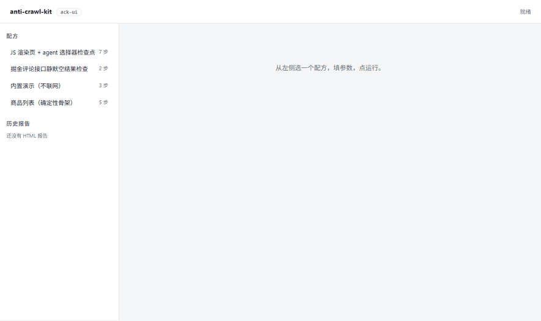

# anti-crawl-kit

中文 · [English](README_EN.md)

浏览器自动化和反爬方向的工具包。接新平台时可以直接从这里起步，少踩一遍
登录态、验证码、改版、静默空结果的坑。

代码来自我自己几个平台采集项目的实践，业务部分（模型、数据库、服务端协议）
已经去掉了。Python 3.10+，浏览器层用 patchright，HTTP 层用 curl_cffi。
给 agent 用的话，先看 [AGENTS.md](AGENTS.md)。

## 安装

```bash
pip install -e ".[all,dev]"
```

也可以分开装：`.[browser]`、`.[http]`、`.[config]`、`.[mcp]`。
只跑逻辑和测试用 `.[dev]`，不需要 patchright。

不装成包也能跑，examples 和 tools 会自动把 `src/` 加进 `sys.path`。

装完先验证（离线，不需要浏览器）：

```bash
python -m pytest tests -q
python -m ruff check .
```

最小安装 `.[dev]` 时，依赖浏览器 / HTTP / YAML / MCP 的用例会自动跳过，
剩下的应该全绿。装了 `.[browser]` 后可以跑真实浏览器集成测试：

```powershell
$env:ACK_BROWSER="1"; python -m pytest tests -m browser -q
```

> 浏览器测试会启动系统 Chrome，默认跑在无头模式；失败时先确认 Chrome 能正常启动。

### Windows / PowerShell

```powershell
python -m venv .venv
.venv\Scripts\python.exe -m pip install -e ".[all,dev]"
.venv\Scripts\python.exe -m pytest tests -q
```

PowerShell 禁止执行脚本时，直接用 `.venv\Scripts\python.exe` 调用即可，
不需要 `Activate.ps1`。

GitHub 直连不稳定时可以用镜像 clone：

```bash
git clone https://gh-proxy.com/https://github.com/Pear303/anti-crawl-kit.git
```

## 先自检

装完先跑一条命令，比照着 README 逐条排查省事：

```bash
ack doctor
```

它会检查 Python 版本、可选依赖、Chrome / Edge、默认端口、`runs` 目录和代理变量，
每个问题都附一条能直接粘的命令：

```text
[OK]    Python 3.13.3 (>= 3.10)
[OK]    anti-crawl-kit 0.15.0
[WARN]  patchright 未安装
        browser_* 步骤不可用
        → pip install "anti-crawl-kit[browser]"
[OK]    Chrome 158.0.8127.36
[OK]    端口 8766 空闲（ack-ui 默认端口）
```

只有阻塞问题（Python 太旧、核心包导入失败、目录不可写）才返回退出码 1。
缺可选依赖只是 WARN，纯逻辑和测试照常能跑。加 `--json` 可以给 CI 用。

## 60 秒演示（不联网）



```bash
ack-ui
```

打开 <http://127.0.0.1:8766>，左侧选「内置演示（不联网）」→ 点运行。
配方只用 `set_var` / `log` / `assert`，不需要浏览器和网络。跑完会生成
`runs/local_demo/latest.html`，左侧「历史报告」里也能回看。

这是验证安装是否完整最快的方式：能看到实时日志、步骤状态和 HTML 报告，
说明控制台、配方引擎、报告渲染三段链路都通了。

不想开网页就用命令行，效果一样：

```bash
ack init recipe              # 生成一个能直接跑的纯逻辑配方
ack-recipe my_recipe.yaml    # 跑它，落盘到 runs/my_recipe/
ack-recipe my_recipe.yaml --baseline auto   # 和上一次对比，退化退出码 1
```

## 离线 fixture

`examples/16_local_fixture.py` 读 `examples/fixtures/` 下三份静态 HTML，
把页面形态判断、DOM 提取、分页、空壳页和验证墙识别一次跑完：

```bash
python examples/16_local_fixture.py
```

不联网、不启动浏览器、不需要额外依赖。改选择器时可以复制一份 fixture
当回归测试，把离线断言和真实站点测试分开，别让网络波动背锅。

## 先跑几个例子

```bash
python examples/01_hello_browser.py   # 启动系统 Chrome，看 webdriver 是不是 false
python examples/02_generic_scrape.py  # 用 YAML 配置抓公开练习站
python examples/05_http_only.py       # 纯 HTTP，不开浏览器
```

当成库用：

```python
from anti_crawl_kit import BrowserSession

with BrowserSession(headless=False, data_dir="./profiles/demo") as page:
    page.goto("https://example.com")
    print(page.title())
    print(page.evaluate("() => navigator.webdriver", isolated_context=False))
```

## 里面有什么

浏览器层用 patchright 配系统 Chrome，profile 持久化并按平台分开，登录一次
可以复用。长循环会检查窗口是否还在，用户关掉浏览器后任务能退出。同域请求
有统一限频，验证码和登录分开计时。碰到验证墙就截图、发通知、停下等人处理，
不重试。

数据不一定在 DOM 里。工具会先判页面形态，再从 JS bundle 里翻接口、拦 XHR
响应，或者从 `__INITIAL_STATE__` 这类全局变量里提 JSON。DOM 采集放在最后，
配置写成 YAML；改版后选择器失效，可以用自适应匹配重新定位。

HTTP 侧走 curl_cffi，403/429 先分类再决定要不要开浏览器。签名接口只定义
契约，不内置任何平台的算法。

工程侧主要是防静默失效：`RunReport` 把「请求成功但 0 条」判成 empty，
`ack-health` 做例行体检，`ack-smoke` 在发版前跑真实站点，profile 缓存有
白名单和清理阈值。`recipe` 用来编排确定性步骤，中间可以停下来交给 agent
判断；`ack-mcp` 把这些能力包成 MCP 工具。

结果不只在终端里看：`ack-report` 把审计、体检、冒烟、评估的 JSON 转成
单文件 HTML（样式和脚本都内嵌，双击就能开）；`ack-ui` 起一个只监听本机
的控制台，选配方、填参数、跑、看实时日志，agent 检查点也能在页面上继续。
每次运行结束会落盘到 `runs/<recipe>/<时间戳>.json|html`，并更新 `latest.*`，
关掉控制台后还能回看；点历史报告里的配方名，直接看最近两次的退化对比。
同一条配方也能用 `ack-recipe` 在命令行跑，
`--baseline auto` 自动和上一次对比，有退化退出码 1，适合 cron 和 CI。

立项阶段可以用 `ack-assess` 走 G0~G4，输出 Go/No-Go 和缺口清单。
`ack init assess` 能直接从 `ack-dom` 的探测结果生成评估配置和路径审计配置，
选择器全部来自真实 DOM，不需要手写；MCP 侧对应 `dom_probe` +
`draft_assessment` + `assess_project`，不碰命令行也能走完一次初步勘察。

## 命令行

```bash
# 自检环境：Python、可选依赖、Chrome/Edge、端口、目录、代理
ack doctor
ack doctor --json                 # 给 CI 用的机器可读输出

# 生成能直接跑的骨架（logic 零依赖 / http / browser）
ack init recipe
ack init recipe --type http --out jobs/daily.yaml
ack init health                   # 等价 ack-health --init

# 从 DOM 探测结果生成 G0~G4 评估配置（选择器来自真实 DOM）
ack init assess --from-probe output/dom.json --out-dir runs/survey

# 一站式探测：给 URL 和目标字段，直接出结论（URL 换成你的目标站）
ack-probe --url "https://example.com" --field fansNum --quick

# 页面结构 / 接口 / 框架
ack-dom --url "https://quotes.toscrape.com/"

# HTML 里没数据时，从 JS 包找接口（零浏览器）
# 退出码：0=找到候选，1=没找到（正常业务结果），2=抓取/参数错误
ack-hunt --url "https://example.com" --field fansNum

# HTTP 够不够，两路实测
ack-bench --repeat 3

# 14 条采集路径逐条审计（默认写 runs/<platform>-<date>/）
ack-audit --config examples/platforms/bilibili_audit.yaml

# 平台健康体检（--init 生成的是 demo 模板，直接跑会 FAIL）
ack-health --init
# 先把 ack_health.yaml 里的模块、类名、cookie 名、选择器改成你的项目，再运行：
ack-health --config ack_health.yaml
ack-health --config ack_health.yaml --browser

# 真实站点冒烟，FAIL 退出码 1
ack-smoke --json smoke.json
ack-smoke --channel msedge

# MCP server
ack-mcp
ack-mcp --transport http --port 8765

# 技术验证评估（默认写 runs/assessment-<name>/）
ack-assess --config examples/assessments/books.yaml

# JSON 报告转单文件 HTML（--dir 递归扫描子目录并生成索引）
# runs/health.json 是示例路径，需先由 ack-health 生成
ack-report --input runs/health.json
ack-report --input benchmarks/baseline-r3/results.json   # 仓库里现成的示例
ack-report --dir runs
ack-report --dir runs --out reports        # 输出到 reports/，保留子目录结构

# 和基线对比：用例变差 / 指标下降 / 用例消失时退出码 1，适合每日监控或 CI
ack-report --input runs/local_demo/latest.json \
           --baseline runs/local_demo/20261113-090000.json
ack-report --input runs/local_demo/latest.json --baseline auto   # 自动找同目录上一次
ack-report --dir runs --baseline auto                            # 每份各自对比，汇总退化

# 命令行跑配方：落盘到 runs/<recipe>/，并可对比上一次
ack-recipe examples/recipes/local_demo.yaml
ack-recipe recipes/daily.yaml --inputs url=https://example.com --baseline auto

# 本地 Web 控制台：选配方、填参数、跑、看日志（http://127.0.0.1:8766）
ack-ui
ack-ui --headed --channel msedge
ack-ui --runs my-runs                      # 报告落盘目录（默认 runs）
```

`ack-smoke`、`ack-assess`、`ack-mcp` 都支持 `--channel msedge` 走 Edge。

`ack-ui` 默认监听 `http://127.0.0.1:8766`，可用 `--host` / `--port` / `--open` 调整。
HTTP API：

```text
GET  /api/recipes                      配方列表（含 id 和 path）
POST /api/run                          {"recipe": "<id 或相对路径>", "inputs": {...}}
GET  /api/jobs/<id>                    job 状态
GET  /api/jobs/<id>/events             SSE 事件流
GET  /api/jobs/<id>/report             本次运行的 HTML 报告
GET  /api/runs                         历史报告（每个配方一份）
GET  /api/runs/history?dir=<目录>      历史列表 + 最近两次对比
```

完整契约和页面约束见 [docs/29](docs/29-可视化报告与本地控制台.md)。

## 采集路径的优先级

JS 包找接口 > HTTP 直连 > SSR 全局状态 > XHR 拦截 > DOM。

越靠前越快、越省资源，也越不容易撞行为检测；越靠后越稳，能拿到登录态数据。
不确定 HTTP 够不够就先跑 `ack-bench`，别凭感觉。

浏览器拦截跑通不算结束。签名参数能导出来重放的话，还是应该降回 HTTP，
不然每个请求都要开一次浏览器。

## 几个容易踩的点

- 不要覆写 UA。固定的 UA 和真实 Chrome 版本、`sec-ch-ua` 对不上，本身就是特征。
- 登录和验证码阶段不要拦图片，二维码和滑块图被 abort 后就永远等不到了。
- 验证墙出现是止损信号，不是重试信号。
- 判断窗口关没关不要用 `destroyed`，导航期间 evaluate 会抛异常，得用探针。

其余的在 [docs/11-工程红线与验收清单.md](docs/11-工程红线与验收清单.md)。

## 质量门禁

改动合并前要过三道机器检查：

```bash
python -m ruff check .                              # 含 examples / scripts
python -m pytest -q                                 # 667 passed / 2 skipped
python -m pytest -q --cov --cov-fail-under=68       # 本地 72%，CI 门槛 68%
```

PR 还要过 `prctl gate`（证据包 / 审核报告 / 安全报告 / 风险审批 / 发布计划）。
高风险路径（发版流程、门禁自身）需要 2 次全新上下文的独立复核。

流程细节见 [CONTRIBUTING.md](CONTRIBUTING.md)。

## 文档

`docs/` 下按场景分：

- 入门：32 三分钟上手、01 决策与方法论、02 patchright 实战规则、04 新平台接入 SOP
- 找数据：09 JS 包找接口、19 数据源选型、22 签名剥离、23 路径审计
- 稳定性：03 防风控、05 排障、06 踩坑、24 健康体检、25 冒烟
- Agent：12 任务模板、15 工作流、17 发现与固化、26 MCP 接入、27 技术验证
- 可视化：29 报告与控制台
- 监控：31 每日监控与退化告警
- 发布：30 发版与 PyPI
- 案例：21 站点形态实测、28 掘金真实采集

变更记录见 [CHANGELOG.md](CHANGELOG.md)。

`examples/` 有 16 个脚本：01/02/05/10~16 可无参数直接运行；03 需要人工扫码登录；
04 需要联网和浏览器；06/08/09 必须传 `--url`；07 必须传平台 YAML 配置。
`tools/` 是命令行入口，实现在 `src/anti_crawl_kit/tools/`。

## 边界

只用来采公开数据，或者你有权限的数据。不要拿它破解验证码、绕访问控制、
采个人隐私。频率控制得保守一点，是为了账号安全，不是为了压着上限跑。

完整说明见 [DISCLAIMER.md](DISCLAIMER.md)。

## License

MIT，见 [LICENSE](LICENSE)。第三方依赖和参考的算法思路见 [NOTICE](NOTICE)。
