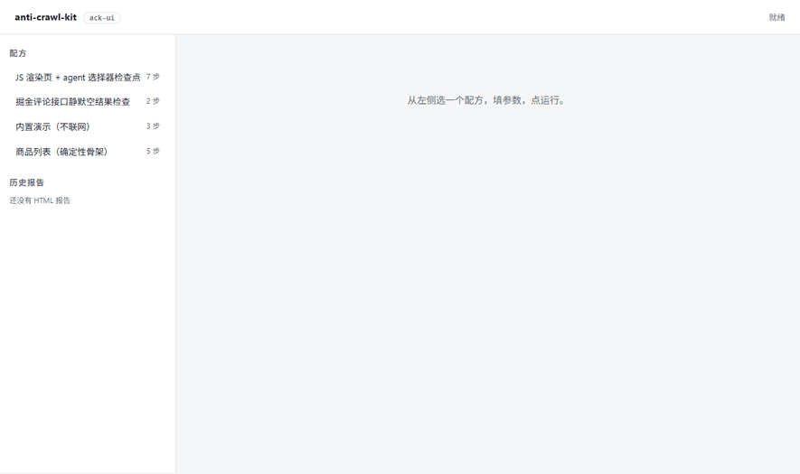

# anti-crawl-kit

[中文](README.md) · **English**

A toolkit for browser automation and anti-bot-aware crawling. Start a new
platform from here instead of re-learning the same lessons about login state,
CAPTCHA walls, redesigns, and silent empty results.

The code comes from several real scraping projects. Business logic (models,
databases, server protocols) has been removed. Python 3.10+, patchright for the
browser layer, curl_cffi for HTTP. If you are an agent, read
[AGENTS.md](AGENTS.md) first.

## Install

```bash
pip install -e ".[all,dev]"
```

Or install only what you need: `.[browser]`, `.[http]`, `.[config]`, `.[mcp]`.
For logic and tests only, `.[dev]` is enough and does not pull patchright.

You can also run the examples and tools without installing: they add `src/`
to `sys.path` automatically.

Verify offline (no browser needed):

```bash
python -m pytest tests -q
python -m ruff check src tests
```

With the minimal `.[dev]` install, tests that need browser / HTTP / YAML / MCP
are skipped automatically. The rest should be green. With `.[browser]` you can
run the real-browser integration tests:

```powershell
$env:ACK_BROWSER="1"; python -m pytest tests -m browser -q
```

> Browser tests launch system Chrome in headless mode. If they fail, check
> that Chrome itself starts.

### Windows / PowerShell

```powershell
python -m venv .venv
.venv\Scripts\python.exe -m pip install -e ".[all,dev]"
.venv\Scripts\python.exe -m pytest tests -q
```

If PowerShell blocks scripts, call `.venv\Scripts\python.exe` directly; you do
not need `Activate.ps1`.

If GitHub is slow, clone through a mirror:

```bash
git clone https://gh-proxy.com/https://github.com/Pear303/anti-crawl-kit.git
```

## Check your environment first

```bash
ack doctor
```

It checks Python, optional dependencies, Chrome/Edge, the default UI port, the
runs directory, and proxy variables. Every problem comes with a copy-paste fix:

```text
[OK]    Python 3.12.4 (>= 3.10)
[OK]    anti-crawl-kit 0.13.1
[WARN]  patchright 未安装
        browser_* steps are unavailable
        → pip install "anti-crawl-kit[browser]"
[OK]    Chrome 131.0.6778.86
[OK]    port 8766 free (ack-ui default)
```

Exit code is `1` only for blocking problems. Missing optional extras are
warnings, because the pure-logic part works without them.

## 60-second demo (offline)



```bash
ack-ui
```

Open <http://127.0.0.1:8766>, pick “内置演示（不联网）” on the left, click Run.
The recipe only uses `set_var` / `log` / `assert`; no browser, no network. It
writes `runs/local_demo/latest.html`, and the run is listed under “历史报告”.

This is the fastest way to prove the install is complete: live logs, step
status, and an HTML report mean the console, recipe engine, and renderer all
work.

Prefer the terminal?

```bash
ack init recipe              # generate a runnable pure-logic recipe
ack-recipe my_recipe.yaml    # run it, persist to runs/
ack-recipe my_recipe.yaml --baseline auto   # compare with the previous run
```

## Offline fixtures

`examples/16_local_fixture.py` runs page-shape detection, DOM extraction,
pagination, empty-shell detection, and CAPTCHA-wall detection against three
static HTML files. No browser, no network, no extra dependencies:

```bash
python examples/16_local_fixture.py
```

Use it as a regression test when you change selectors: copy the fixture, assert
on it, and keep real-site tests separate.

## What is inside

The browser layer uses patchright with system Chrome. Profiles are persistent
and separated per platform, so you log in once and reuse it. Long loops notice
when the window is gone; rate limiting is per domain; CAPTCHA and login timers
are separate. When a challenge wall appears, it screenshots, notifies, and
stops. No retries.

Data is not always in the DOM. The toolkit classifies the page shape first,
then looks for API endpoints in JS bundles, intercepts XHR responses, or reads
JSON from globals such as `__INITIAL_STATE__`. DOM scraping comes last, driven
by YAML. When a redesign breaks selectors, adaptive matching can relocate them.

HTTP goes through curl_cffi. 403/429 are classified before deciding whether to
open a browser. Signed endpoints only have a contract; no platform-specific
signing algorithm is bundled.

The engineering side focuses on preventing silent failures: `RunReport` marks
“HTTP 200 but 0 rows” as `empty`, `ack-health` does routine checks, `ack-smoke`
runs real sites before a release, and the profile cache has an allowlist and
cleanup thresholds. `recipe` orchestrates deterministic steps and can pause for
an agent decision; `ack-mcp` exposes these capabilities as MCP tools.

Results are not terminal-only: `ack-report` turns audit / health / smoke /
assessment JSON into a single self-contained HTML file. `ack-ui` serves a
localhost-only console where you can pick a recipe, fill inputs, run it, watch
live logs, and resume agent checkpoints. Every run is persisted to
`runs/<recipe>/<timestamp>.json|html` plus `latest.*`, so history survives a
restart. Clicking a recipe name in the history panel shows a diff against the
previous run. `ack-recipe` runs the same recipes from the command line;
`--baseline auto` compares against the previous run and exits `1` on regression,
which fits cron and CI.

`ack-assess` walks G0–G4 before you commit to a project and outputs a Go/No-Go
plus a gap list.

## CLI

```bash
# One-shot probe: URL + target field, get a conclusion
ack-probe --url "https://example.com" --field fansNum --quick

# Page structure / endpoints / framework
ack-dom --url "https://quotes.toscrape.com/"

# When HTML has no data, find endpoints in JS bundles (no browser)
# exit 0 = candidates found, 1 = none (a normal result), 2 = fetch/argument error
ack-hunt --url "https://example.com" --field fansNum

# Is plain HTTP enough? measure both paths
ack-bench --repeat 3

# Audit 14 collection paths one by one
ack-audit --config examples/platforms/bilibili_audit.yaml

# Platform health checks (--init generates a demo template that FAILs on purpose)
ack-health --init
ack-health --config ack_health.yaml

# Real-site smoke test, exit 1 on FAIL
ack-smoke --json smoke.json
ack-smoke --channel msedge

# MCP server
ack-mcp

# Technical assessment (G0–G4)
ack-assess --config examples/assessments/books.yaml

# JSON report -> single-file HTML (--dir also builds an index)
ack-report --input runs/health.json
ack-report --dir runs
ack-report --input runs/local_demo/latest.json --baseline auto
ack-report --dir runs --baseline auto

# Run a recipe from the CLI, persist, compare with the previous run
ack-recipe examples/recipes/local_demo.yaml
ack-recipe recipes/daily.yaml --inputs url=https://example.com --baseline auto

# Local web console
ack-ui
ack-ui --headed --channel msedge
ack-ui --runs my-runs
```

`ack-smoke`, `ack-assess`, and `ack-mcp` accept `--channel msedge`.

`ack-ui` listens on `http://127.0.0.1:8766` by default; `--host` / `--port` /
`--open` adjust that. HTTP API:

```text
GET  /api/recipes                      recipe list (id + path)
POST /api/run                          {"recipe": "<id or path>", "inputs": {...}}
GET  /api/jobs/<id>                    job status
GET  /api/jobs/<id>/events             SSE event stream
GET  /api/jobs/<id>/report             HTML report for this run
GET  /api/runs                         persisted reports (one per recipe)
GET  /api/runs/history?dir=<folder>    history + latest-vs-previous diff
```

Full contract: [docs/29](docs/29-可视化报告与本地控制台.md) (Chinese).

## Collection priority

1. API endpoint found in JS bundles → direct HTTP
2. Plain HTTP (curl_cffi)
3. SSR state (`__NEXT_DATA__`, `__INITIAL_STATE__`, …)
4. XHR interception in a browser
5. DOM selectors + adaptive relocation

Validation walls are a stop signal: screenshot, notify, hard stop. No retry, no
CAPTCHA solving.

## Docs

`docs/` is organized by scenario (Chinese):

- Getting started: 32 three-minute setup, 01 methodology, 02 patchright rules, 04 platform onboarding SOP
- Finding data: 09 JS bundle endpoints, 19 data source selection, 22 signature
  stripping, 23 path audit
- Stability: 03 anti-bot, 05 troubleshooting, 06 pitfalls, 24 health checks,
  25 smoke tests
- Agent: 12 task templates, 15 workflows, 17 discovery, 26 MCP, 27 assessment
- Visualization: 29 reports and console
- Monitoring: 31 daily monitoring and regression alerts
- Release: 30 release and PyPI
- Case studies: 21 site shapes, 28 Juejin real-world run

`examples/` has 16 scripts: 01/02/05/10–16 run without arguments; 03 needs a
manual QR login; 04 needs network and a browser; 06/08/09 require `--url`;
07 requires a platform YAML.

## Boundary

Use it for public data, or data you are allowed to collect. Do not use it to
break CAPTCHAs, bypass access control, or collect personal data. Conservative
rate limits are there to protect your account, not to push the ceiling.

See [DISCLAIMER.md](DISCLAIMER.md) for details.

## License

MIT, see [LICENSE](LICENSE). Third-party dependencies and referenced algorithm
ideas are listed in [NOTICE](NOTICE).
